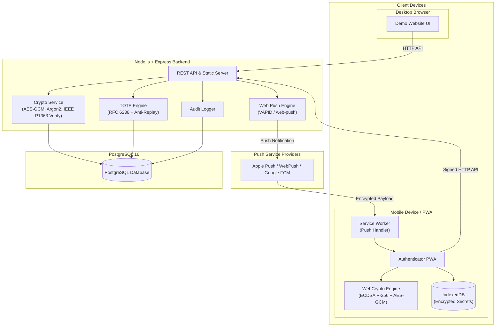
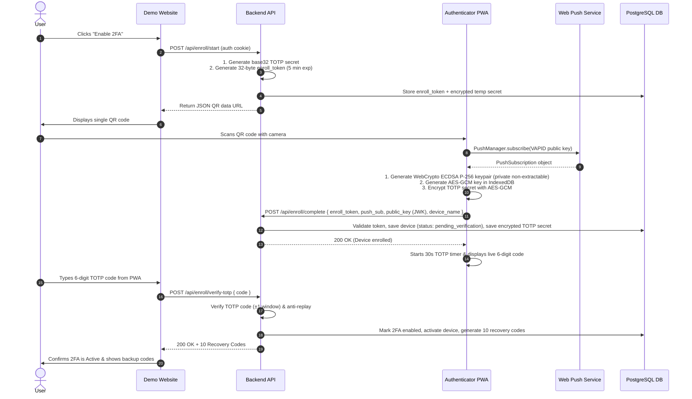
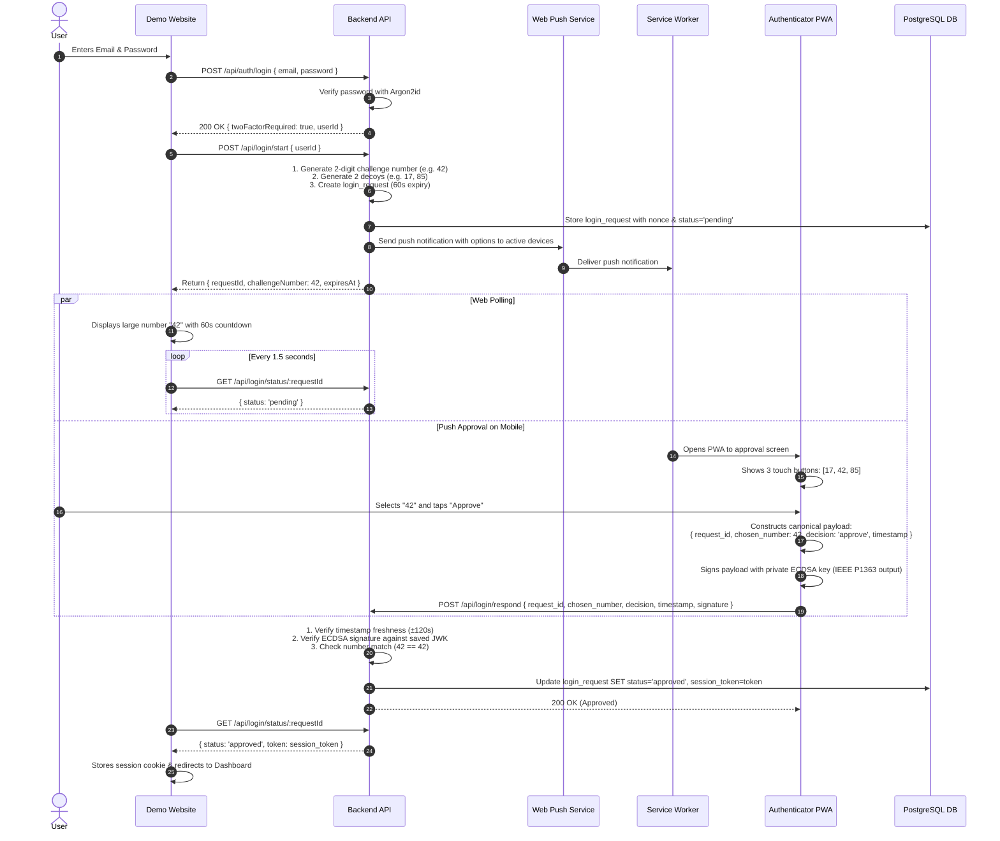
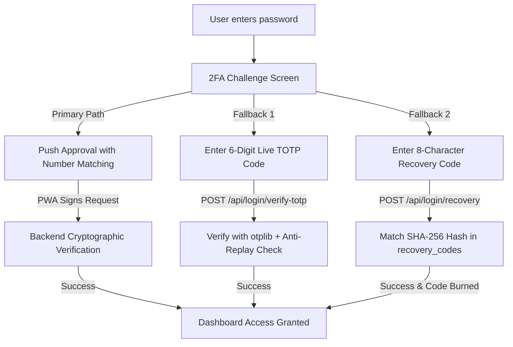

# Architecture & Flow Specification

This document details the architectural design and cryptographic workflows of the unified Authenticator PWA with dual TOTP and Web Push approval.

---

## 1. High-Level Architecture

---

## 2. Unified Enrollment Flow (Single QR Code)

When a user enables 2FA, scanning **ONE** QR code registers the device for both RFC 6238 TOTP and Web Push approval.

---

## 3. Login Flow with Number Matching (Push Fatigue Defense)

---

## 4. Fallback Login Workflows

If the user does not have push connectivity or loses their phone:

---

## 5. Security & Cryptographic Invariants

| Layer | Implementation | Security Properties |
|---|---|---|
| **TOTP Secret At Rest** | AES-256-GCM with 96-bit random IV & 128-bit authentication tag | Confidentiality & integrity; ciphertext cannot be read if DB is compromised. |
| **Password Hashing** | Argon2id (`m=65536, t=3, p=1`) | Memory-hard defense against GPU/ASIC brute force attacks. |
| **PWA Private Keys** | WebCrypto `SubtleCrypto.generateKey` (`extractable: false`) | Key material is hardware-bound in the browser and cannot be extracted via JavaScript inspection. |
| **PWA Secret Storage** | IndexedDB with local non-extractable AES-GCM key | Stored secrets are encrypted even within client browser storage. |
| **Push Approval Signatures** | ECDSA with curve P-256 and SHA-256 (IEEE P1363 raw signature) | Cryptographically authenticates the physical device that approved the request. |
| **Push Fatigue Defense** | 2-digit number challenge matching | Prevents users from mindlessly approving unsolicited push prompts. |
| **Anti-Replay Protection** | Timestamp freshness check (120s) + Single-use token tracking in database | Prevents interception and resubmission of approved payloads. |

